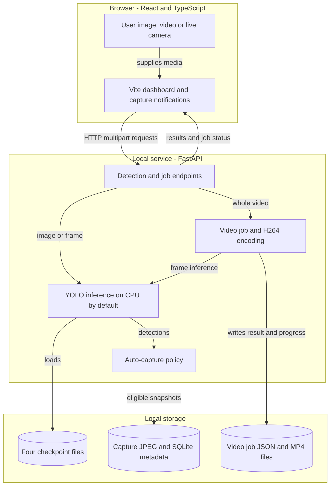
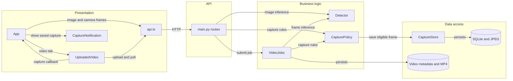

# Architecture Diagram

The local React/Vite dashboard sends image frames or whole videos to a FastAPI service, which runs four local YOLO checkpoints and optionally saves annotated captures. This diagram describes the current implementation rather than a proposed migration.

## Application Architecture

<!-- mermaid-checked: no \n, no em-dash/en-dash, no {} in labels, subgraphs are id["label"], arrows are -->|"label"|, all subgraphs closed by end, ids unique -->

### Technology Stack Summary

| Layer | Technology | Version | Purpose |
|---|---|---|---|
| Browser | React, TypeScript, Material UI, Vite | See `package.json` | Media upload, camera preview, settings, job polling, capture notifications |
| HTTP API | FastAPI, Pydantic, Uvicorn | See `backend/requirements.txt` | Validate input, expose image, video, model, and capture endpoints |
| Inference | Ultralytics YOLO, Pillow | Ultralytics 8.3.228 | Load local YOLO weights, run selected class inference, annotate frames |
| Video | PyAV, imageio-ffmpeg | See `backend/requirements.txt` | Decode timestamps, encode H.264, retain original audio |
| Storage | SQLite and local JPEG, MP4, JSON files | SQLite bundled with Python | Persist captures and recover recent video jobs |

### Data Storage & External Services

Model weights are local under `backend/models/`. Capture images and `captures.sqlite3` live under `captures/`; video job metadata and completed MP4 files live under `video_jobs/`. No external inference API or message broker is used at runtime; the development Vite server proxies `/api` requests to local FastAPI.

### Key Architectural Decisions

- The selected v0 or v1 six-class model runs per request; the separate rifle and COCO person models run only if their classes are selected.
- A single inference lock serializes model prediction. Video jobs have one worker, persist progress to JSON, and preserve frame presentation timestamps and audio.
- A capture needs an enabled object class and person above independent thresholds in the same frame and must pass a shared cooldown.

## Component Relationships

<!-- mermaid-checked: no \n, no em-dash/en-dash, no {} in labels, subgraphs are id["label"], arrows are -->|"label"|, all subgraphs closed by end, ids unique -->

### Component Inventory

| Component | Layer | Type | Responsibility |
|---|---|---|---|
| `App.tsx` | Presentation | React component | Image upload, live camera loop, settings, and notifications |
| `UploadedVideo.tsx` | Presentation | React component | Whole-video submission, status polling, cancel, playback, download |
| `CaptureNotification.tsx` | Presentation | React component | Saved capture pop-up with warning or success styling |
| `api.ts` | Presentation | HTTP client | Validates media and submits settings and files |
| `main.py` | API | FastAPI routes | Validates requests, dispatches inference or jobs, returns resources |
| `detector.py` | Business logic | YOLO wrapper | Loads checked class schemas, filters predictions, annotates frames |
| `videos.py` | Business logic | Job manager | Decodes and processes every video frame, encodes H.264, muxes audio |
| `captures.py` | Business and data | Policy and store | Applies capture thresholds and cooldown, stores JPEG and SQLite metadata |
